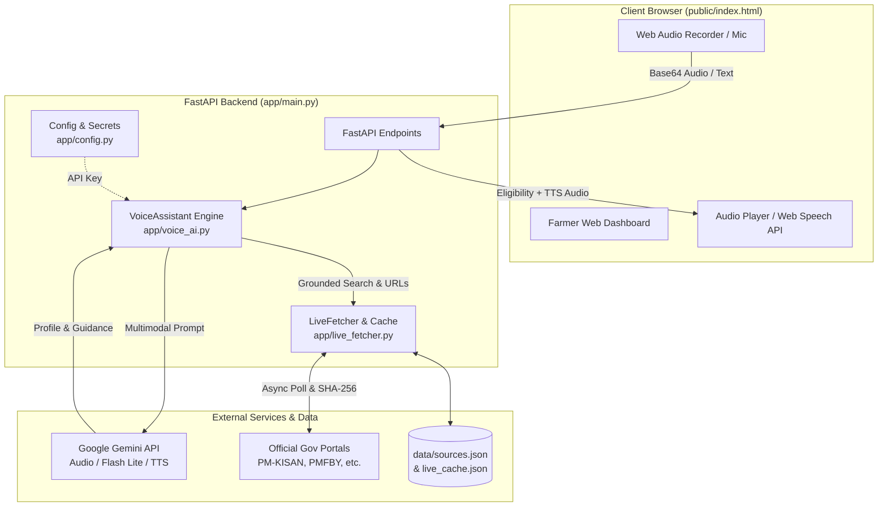

# 🌾 Smart Farmer Government Scheme Assistant

[](LICENSE)
[](pyproject.toml)
[](https://fastapi.tiangolo.com/)
[](https://aistudio.google.com/)
[](docker-compose.yml)
[](tests/)

A modern, voice-first web application that helps Indian farmers find central and state government agricultural schemes they may qualify for. It combines multimodal generative AI (Google Gemini via Google AI Studio free tier), deterministic eligibility evaluation, real-time portal web scraping, and multilingual voice synthesis.

> **Disclaimer:** This application is an informational guide and advisory tool, not an official government agency. Scheme benefits, criteria, quotas, and application deadlines may change. Always verify details on the official government portals before applying.

---

## Table of Contents

- [Overview](#overview)
- [Key Features](#key-features)
- [Architecture Summary](#architecture-summary)
- [Quick Start](#quick-start)
  - [Option A: 1-Command Docker Setup (Recommended)](#option-a-1-command-docker-setup-recommended)
  - [Option B: Local Python Environment](#option-b-local-python-environment)
- [Environment Configuration](#environment-configuration)
- [Usage Guide](#usage-guide)
  - [Using the Web Interface](#using-the-web-interface)
  - [REST API Endpoints](#rest-api-endpoints)
- [Running Unit Tests](#running-unit-tests)
- [Project Structure](#project-structure)
- [Contributing](#contributing)
- [Security](#security)
- [License](#license)

---

## Overview

Navigating government agricultural subsidies, insurance schemes, and welfare benefits across central and state departments is often challenging for farmers due to language barriers, complex eligibility criteria, and scattered documentation. 

**Smart Farmer Scheme Assistant** bridges this gap:
- Farmers can simply speak into their browser or phone in their native language (e.g., Hindi, English, and regional dialects).
- Multimodal AI extracts farmer profiles (acres, crops, category, state, irrigation) and cross-checks them against structured eligibility rules.
- Live web scrapers periodically inspect official portals (e.g., PM-KISAN, PMFBY, Soil Health Card) for newly published guidelines, circulars, and notifications.
- Audio synthesis speaks actionable results back to the farmer in clear, plain language.

---

## Key Features

- **🎙️ Voice-First Interaction (`app/voice_ai.py`, `public/index.html`)**:
  Farmers tap **Tap to Speak** and talk naturally. The assistant extracts profile parameters from audio or transcripts using Google Gemini (`gemini-2.5-flash` or `gemini-3.5-flash-lite`), evaluates eligibility deterministically, and replies with spoken guidance.
- **🌐 Real-Time Government Portal Monitoring (`app/live_fetcher.py`)**:
  Asynchronously polls official government `https://` portals with `httpx` and parses updates using `BeautifulSoup` and `pypdf`. Uses SHA-256 content hashing to detect changes and surface active circulars.
- **🔒 Isolated Secrets & Privacy by Design (`app/config.py`)**:
  Sensitive API credentials reside exclusively in `env/.env` (gitignored). Keys are loaded on the server only and never exposed to the client or embedded into AI prompts.
- **🔊 Multilingual TTS & Fallback Speech**:
  Provides dual-layer speech playback: browser-side speech synthesis and server-side neural TTS via Gemini or local offline speech engines (`sherpa-onnx` / `pyttsx3`).
- **🛡️ Rate-Limit Resilience**:
  If external AI models experience temporary rate limits (429), the system automatically falls back to live portal notice summaries without interrupting user experience.

---

## Architecture Summary



### Component Breakdown
- **`app/main.py`**: FastAPI application entrypoint, lifespan background polling, and REST route controllers.
- **`app/voice_ai.py`**: Audio preprocessing, Gemini multimodal prompting, and eligibility rule evaluations.
- **`app/live_fetcher.py`**: Asynchronous HTTP crawler with SHA-256 change detection and PDF circular extraction.
- **`ai_service/`**: Voice specification catalog, model metadata synchronization, and local TTS engines.
- **`public/`**: Clean, accessible HTML/CSS/JavaScript web interface.
- **`data/`**: Scheme source definitions (`sources.json`) and active cached snapshot data (`live_cache.json`).

---

## Quick Start

### Option A: 1-Command Docker Setup (Recommended)

Requires [Docker](https://docs.docker.com/get-docker/) and [Docker Compose](https://docs.docker.com/compose/).

1. **Clone the repository:**
   ```bash
   git clone https://github.com/<your-username>/smart-farmer-scheme-assistant-python.git
   cd smart-farmer-scheme-assistant-python
   ```

2. **Configure your Gemini API key:**
   ```bash
   cp env/.env.example env/.env
   ```
   Edit `env/.env` and paste your Google AI Studio API key:
   ```env
   GEMINI_API_KEY=your_gemini_api_key_here
   ```

3. **Start the container:**
   ```bash
   docker compose up --build
   ```

4. **Access the application:**
   Open **http://127.0.0.1:3000** in your browser.

---

### Option B: Local Python Environment

Requires **Python 3.10+** and `pip`.

1. **Clone the repository:**
   ```bash
   git clone https://github.com/<your-username>/smart-farmer-scheme-assistant-python.git
   cd smart-farmer-scheme-assistant-python
   ```

2. **Create and activate a virtual environment:**

   - **Windows (PowerShell):**
     ```powershell
     python -m venv .venv
     .venv\Scripts\Activate.ps1
     ```

   - **Linux / macOS:**
     ```bash
     python3 -m venv .venv
     source .venv/bin/activate
     ```

3. **Install dependencies:**
   ```bash
   pip install -e .
   ```

4. **Set up the environment file:**
   - **Windows:**
     ```powershell
     copy env\.env.example env\.env
     ```
   - **Linux / macOS:**
     ```bash
     cp env/.env.example env/.env
     ```
   Open `env/.env` and set your `GEMINI_API_KEY`. You can also run the interactive helper:
   ```bash
   python setup_env.py
   ```

5. **Run the test suite:**
   ```bash
   python -m unittest discover -s tests -v
   ```

6. **Start the application:**
   ```bash
   python -m app
   ```

7. **Open your browser:**
   Navigate to **http://127.0.0.1:3000**.

---

## Environment Configuration

Configuration variables are managed through environment variables or the `env/.env` file:

| Variable | Required | Default | Description |
| :--- | :---: | :---: | :--- |
| `GEMINI_API_KEY` | **Yes** (for AI) | *None* | Google AI Studio API key for voice, profile extraction, and TTS. |
| `PORT` | No | `3000` | Port for the FastAPI web server to listen on. |
| `HOST` | No | `127.0.0.1` | Host address to bind (`0.0.0.0` for Docker containerization). |
| `LIVE_SYNC_INTERVAL_SECONDS` | No | `900` | Interval in seconds between background portal sync cycles (15 min). |
| `DISABLE_LIVE_SYNC` | No | *Empty* | Set to `1` to disable background automated portal web scraping. |

> [!NOTE]
> Even if `GEMINI_API_KEY` is not provided immediately, the application boots successfully, serves the portal dashboard, and queries cached scheme records. AI voice capabilities become active once the key is saved.

---

## Usage Guide

### Using the Web Interface

1. **Voice Search**: Click **Tap to Speak** and grant microphone permissions. Speak naturally:
   > *"I have 2 acres in Madhya Pradesh, growing wheat with borewell irrigation. Am I eligible for PM-KISAN or drip subsidy?"*
2. **Text Search**: Type criteria (acres, crop, state, farmer category) directly into the query input.
3. **Review Scheme Matches**: The app displays matching central and state schemes, estimated financial assistance, and official portal links.
4. **Live Government Circulars**: View the latest updates and circulars pulled directly from official department sites.

### REST API Endpoints

| Method | Endpoint | Description |
| :--- | :--- | :--- |
| `GET` | `/` | Serves the web dashboard (`public/index.html`). |
| `GET` | `/api/health` | Health check endpoint returning status and cached source counts. |
| `GET` | `/api/voice-status` | Returns Gemini API configuration state and active model IDs. |
| `POST` | `/api/voice-assist` | Multimodal endpoint accepting base64 audio or transcript to extract profile and match schemes. |
| `POST` | `/api/tts` | Synthesizes spoken audio for a given text snippet using Gemini TTS. |
| `GET` | `/api/sources` | Lists configured government portals and their latest cached status. |
| `POST` | `/api/sources` | Adds a new official government scheme portal URL to monitor. |
| `GET` | `/api/live/status` | Current crawl status across monitored portals and recent notifications. |
| `POST` | `/api/live/refresh` | Triggers on-demand crawl and parsing across monitored portals. |
| `GET` | `/api/notifications` | Returns recent scheme updates and circular notifications. |
| `GET` | `/api/ai/models` | Returns available Gemini model specifications. |
| `POST` | `/api/ai/models/sync` | Fetches and syncs active Gemini free-tier model catalog. |

---

## Running Unit Tests

Unit tests validate configuration parsing, live fetching logic, voice pipeline fallbacks, and API endpoints:

```bash
python -m unittest discover -s tests -v
```

All tests execute hermetically without requiring an external internet connection or live API key.

---

## Project Structure

```text
smart-farmer-scheme-assistant-python/
├── .github/
│   ├── ISSUE_TEMPLATE/
│   │   ├── bug_report.md
│   │   └── feature_request.md
│   └── workflows/
│       └── ci.yml
├── ai_service/
│   ├── config.py              # Model spec loading and selection
│   ├── local_tts.py           # Offline TTS fallback implementations
│   ├── models.json            # Active model mappings
│   └── sync_models.py         # Dynamic Gemini model synchronization
├── app/
│   ├── __init__.py
│   ├── __main__.py            # Module entry point (python -m app)
│   ├── config.py              # Environment and secret loader
│   ├── context_index.py       # Scheme indexing and matching logic
│   ├── live_fetcher.py        # Asynchronous portal scraper & change detector
│   ├── main.py                # FastAPI ASGI application and endpoints
│   └── voice_ai.py            # Multimodal Gemini assistant & rules
├── data/
│   ├── live_cache.json        # Snapshot cache of scraped portal notices
│   └── sources.json           # Catalog of official government portals
├── env/
│   ├── .env.example           # Environment template
│   └── .env                   # Local secrets (gitignored)
├── public/
│   └── index.html             # Single-page web dashboard
├── tests/
│   └── test_app.py            # Comprehensive test suite
├── CONTRIBUTING.md            # Guidelines for open-source contributors
├── Dockerfile                 # Container image specification
├── docker-compose.yml         # 1-command container orchestration
├── LICENSE                    # MIT License
├── pyproject.toml             # Package metadata and dependencies
├── README.md                  # Project documentation (this file)
├── requirements.txt           # Dependency manifest
├── SECURITY.md                # Vulnerability disclosure policy
└── setup_env.py               # Interactive environment configuration helper
```

---

## Contributing

Contributions are welcomed! Please see [CONTRIBUTING.md](CONTRIBUTING.md) for details on code style, branch workflows, and pull request guidelines.

---

## Security

For security vulnerability disclosure, please refer to our [Security Policy](SECURITY.md). Please do not report security issues via public GitHub issues.

---

## License

This project is licensed under the **MIT License**. See the [LICENSE](LICENSE) file for complete details.
